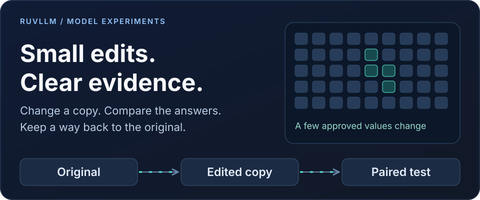
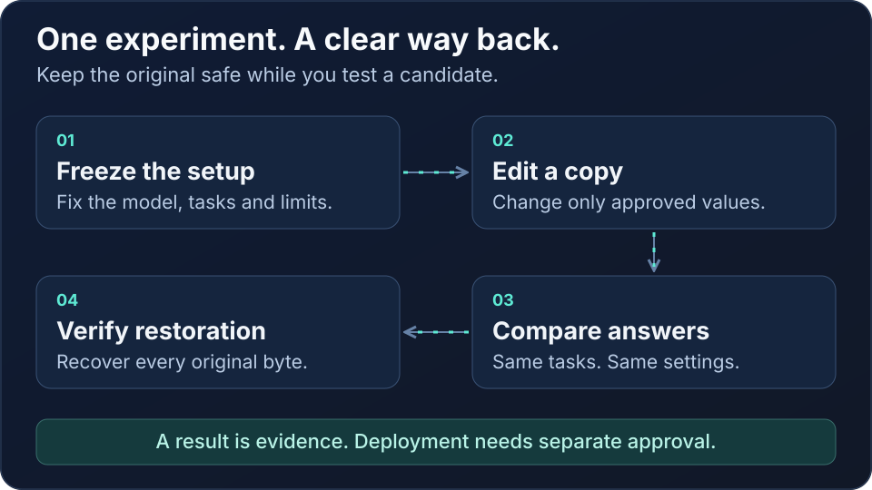

<p align="center"></p>

# RuVLLM

**Inspect model weights, make bounded changes, measure what improved, and restore the original bytes.**

RuVLLM brings a native Rust weight editor, a small coding adapter, local model serving, and reproducible benchmark evidence into one research repository. It helps answer a practical question: can a targeted model change make a specific workflow better without quietly breaking another one?

The repository includes working source, the selected 4B adapter in PEFT and MLX formats, frozen evaluation data, raw completed responses, and executable checks. The measured gains are modest and specific. State of the art performance, broad production readiness, and recursive self improvement are not established.

[Quick start](#quick-start) · [Benchmarks](#measured-results) · [Native editor](native/README.md) · [Adapter](weights/coding-4b/README.md) · [ADR 011](docs/adr/ADR-011-governed-neural-weight-evolution.md)

## What you can do

| Capability | What happens | Current boundary |
| :--- | :--- | :--- |
| Inspect | Read selected Safetensors tensors, statistics and digests | Weight statistics; activation capture is not implemented |
| Patch | Edit allowed BF16 or F32 values into a new checkpoint | Explicit tensor, index, count and delta limits |
| Restore | Reconstruct the exact original checkpoint into a new file | Full file digest and byte comparison |
| Evaluate | Run paired model benchmarks and audit saved outputs | The native `evaluate` operation validates receipts; external runners perform inference |
| Package | Write an RVF artifact containing edits and evidence | Integrity checks do not grant deployment authority |
| Serve | Load the selected 4B adapter behind a local API and Claude Code Router | Apple Silicon, text and tools, one request at a time |
| Govern | Keep proposal, evaluation and activation separate | Core Memory integration is an external reference; this repository provides no production activation tool |

The native component is an extraction of the tested RuVector weight evolution engine. It retains its original engine, CLI and test bytes. This repository packages that component alongside the coding experiment; it does not contain the entire RuVector inference stack. [Native provenance](native/upstream-provenance.json) records the exact source files and digests.

## Measured results

### A small coding adapter improved the local pilot

The base model is [Qwen3.5 4B](https://huggingface.co/Qwen/Qwen3.5-4B), pinned to a specific revision. Training changed 1,507,328 adapter parameters across 16 MLP output projections using rank 8 LoRA. In plain language, a small learned addition changes how the frozen base responds. The selected checkpoint trained for 64 steps on original synthetic examples.

These measurements compare the same MLX 4 bit base with and without the adapter on an Apple M4 Pro with 48 GiB memory. Development data selected the checkpoint. The following release evaluations were excluded from selection.

| Completed evaluation | Original | With adapter | Observed change |
| :--- | :--- | :--- | :--- |
| Synthetic release | 29 / 35 | 32 / 35 | 3 additional passes |
| Tool subset of that release | 25 / 27 | 27 / 27 | 2 additional valid tool calls |
| Code subset of that release | 4 / 8 | 5 / 8 | 1 additional tested function |
| HumanEval, local chat protocol | 123 / 164 | 128 / 164 | 75.00% to 78.05%, up 3.05 percentage points |
| HumanEval elapsed time | 547.5 s | 607.4 s | 10.94% longer |

The HumanEval result contains **13 gains and 8 regressions**. Its exact paired McNemar p value is 0.383, so the aggregate improvement is not statistically conclusive. The synthetic release has 3 gains and no regressions, with p = 0.25. Tool and code subset rows overlap the 35 case release and must not be added as separate experiments. [Raw evidence and verification](benchmarks/README.md) make these limits inspectable.

The practical result is a promising specialist preview. It passed a real Claude Code Read, Edit and Bash repair fixture with four independent assertions in 20.8 seconds. That single fixture does not establish performance on large repositories, long conversations or sustained tool recovery. Keep a stronger model available for unsupported work.

### Fewer tokens did not guarantee better answers

The separate native experiment reproduced a published Qwen3.5 0.8B intervention. It changed **130,188 BF16 values across two allowed tensors**. It did not discover a new repair method or apply this edit to the 4B coding model.

<p align="center"></p>

| Completed 0.8B experiment | Original | Edited |
| :--- | :--- | :--- |
| Direct mode, delivered correct | 13 / 16 | 12 / 16 |
| Direct mode, completed | 13 / 16 | 14 / 16 |
| Direct mode, output tokens | 13,458 | 10,713 |
| Direct mode, generation time | 113.55 s | 90.53 s |
| Thinking mode, delivered correct | 1 / 16 | 3 / 16 |

On this M4 Pro BF16 MLX experiment, direct mode used 20.40% fewer tokens and 20.27% less generation time. Delivered accuracy fell from 81.25% to 75.00%. There were 2 gains and 3 regressions, with p = 1.0. **The quality gate failed and production activation remained unauthorized.**

A completed answer can still be wrong. An answer found inside unfinished reasoning can still fail to reach the user. The evaluator records correctness, completion, delivered correctness and truncation separately. The stronger unedited direct configuration remains the primary comparison; the weak thinking baseline is reported separately.

This was 16 fresh synthetic arithmetic questions with a 2,048 token cap, one paired seed per case, and template families shared with development. It was not the published MATH 500 evaluation. The [original research](https://rikiyat.github.io/blog/weight-space-programming/) and [pinned intervention source](https://github.com/RikiyaT/lm_understand-logs/tree/4d09ba6d6a7e891dd8063974dfe81b3d78e3494f/exp8_math) receive separate attribution.

### Mechanical improvements are independently checkable

| Check | Observed result |
| :--- | :--- |
| Native engine focused tests | 17 passed |
| Standalone Rust workspace tests | 508 passed, no failures or ignored tests |
| Historical native patch | 130,188 changed values in 6.692 seconds |
| Historical native rollback | All 1,746,942,600 original bytes restored; SHA256 and byte comparison agree |
| HTTP adapter binding | All 32 loaded adapter tensors checked against the selected weight file |
| New CPU smoke fixture | Real inspect, patch, rejection, rollback and RVF checks without a model download |

The server binding check fixes a concrete failure: MLX LM model lookup could drop the configured adapter when an HTTP request named the model. The server now binds the base and adapter together and checks the loaded tensors. Earlier affected HTTP receipts were invalidated. The direct offline benchmark results were unaffected.

Test counts establish tested software behavior, not model intelligence. The new standalone Rust build has its own binary digest and is never substituted into historical benchmark receipts. [Native validation](native/validation.json) and [benchmark evidence](benchmarks/README.md) preserve that distinction.

### Broader GPU comparison

A separate frozen Vast experiment compares five BF16 artifacts from three models across two Qwen families: original and edited Qwen3.5 0.8B, original and adapted Qwen3.5 4B, and unchanged Qwen3 Coder 30B A3B. Five direct arms plus two 0.8B thinking arms produce 1,851 planned responses across 164 coding tasks, 27 tool cases and 128 procedural math problems.

**Cloud accuracy results are pending.** The protocol and public source are included under [research/vast_cross_model](research/vast_cross_model/README.md). Partial throughput observations are not substituted for a completed quality report. Final raw responses, independent scores and cleanup evidence will be added after verification. GPU and Apple measurements remain separate experiments.

## Quick start

### Verify the included evidence without a GPU

Use Python 3.12 or newer. These checks read the public evidence; they do not download a model, rent compute or execute generated benchmark code.

```sh
git clone https://github.com/ruvnet/ruvllm.git
cd ruvllm
python3 scripts/verify_benchmarks.py
python3 scripts/check_repository.py
```

The benchmark verifier recomputes saved outcome totals and paired comparisons, and independently grades the saved 0.8B math text. Rechecking saved HumanEval verdicts does not rerun their generated programs. The full original code evaluation used a restricted macOS Seatbelt sandbox.

### Run the native lifecycle on a small CPU fixture

Install the pinned Rust toolchain, then run:

```sh
cd native
python3 verify_source.py
cargo test --locked --workspace
cargo build --locked --release --bin weight_evolution
python3 smoke.py
cd ..
```

The smoke test creates a tiny BF16 checkpoint, applies a permitted edit, rejects protected and overwrite attempts, restores the original bytes, packages RVF evidence and verifies it. Its evaluation counts are synthetic contract fixtures. No model inference or production activation occurs.

The CLI accepts JSON on stdin. See the [native guide](native/README.md) for request schemas, policy limits and trust assumptions.

### Serve the included coding adapter on Apple Silicon

The repository includes both adapter formats under [weights/coding-4b](weights/coding-4b/README.md). Base model weights are downloaded separately. Python 3.12 and roughly 12 GB of download and model storage are required for the recorded local profile.

```sh
python3 -m venv .venv
.venv/bin/python -m pip install -r requirements.lock
.venv/bin/python -m pip install -e .
.venv/bin/python -m ruflo_model.prepare
.venv/bin/python scripts/serve.py \
  --model models/base-4bit \
  --adapter weights/coding-4b/mlx
```

Configure an OpenAI Chat provider in your router with base URL `http://127.0.0.1:9100/v1`, model `ruflo-code-4b`, and the generated key in `runtime/server/api-key`. The historical Python module and model alias retain their names for compatibility.

Use `CLAUDE_CODE_MAX_OUTPUT_TOKENS=4096`, `MAX_THINKING_TOKENS=0`, and `CLAUDE_CODE_DISABLE_ADAPTIVE_THINKING=1` in the client environment. The local profile accepts text and tool messages, enforces 16,384 total tokens and at most 8,192 output tokens, and queues one request at a time. Larger context quality and concurrent serving have not been validated. The internal backend is intended for a trusted single user computer.

[Claude Code Router](https://github.com/musistudio/claude-code-router) compatibility was exercised with CCR 3.1.3 and Claude Code 2.1.316. Anthropic's [gateway documentation](https://code.claude.com/docs/en/llm-gateway) does not establish official support for non Claude models. Client tool permissions remain authoritative; the gateway does not execute tools or change global Claude settings.

For the isolated router fixtures, install the pinned CCR dependencies before running the supplied acceptance scripts:

```sh
mkdir -p vendor/ccr
cp configs/ccr-package.json vendor/ccr/package.json
cp configs/ccr-package-lock.json vendor/ccr/package-lock.json
npm ci --prefix vendor/ccr
.venv/bin/python scripts/router_ccr.py start
.venv/bin/python scripts/accept_router.py --label read-check
.venv/bin/python scripts/accept_coding.py --label repair-check
```

## How the governed workflow works

<p align="center"></p>

1. **Freeze the experiment.** Record the original checkpoint, prompts, allowed changes, decoding settings, evaluator and budget before collecting release results.
2. **Create a new candidate.** Apply bounded edits or train an adapter. Preserve the source checkpoint and record every changed value or tensor.
3. **Measure paired behavior.** Run the original and candidate under the same conditions. Save responses before interpreting correctness, completion and cost.
4. **Check independent evidence.** Verify model and protocol identities, raw output hashes, task coverage and regression counts. Reject mixed model generations.
5. **Request activation authority separately.** A passing score or valid signature alone cannot activate a model. Core Memory owns the external authority decision.
6. **Keep an exact restoration path.** Verify original bytes and record rollback. Model generation changes require fresh cache identity and consistent serving peers.

The local Core Memory reference exercised separate proposer, evaluator and readback credentials under one operator. This is process separation, not certification by an independently operated evaluator. The real 16 case math result failed its quality policy and retained generation 0.

| Component | Role in this repository and reference architecture |
| :--- | :--- |
| RuVLLM | Native weight mechanisms, model serving integration and experimental runners |
| Ruflo | Scoped Claude Code plugin and orchestration integration |
| Core Memory | External authorization, lineage and activation authority |
| MetaHarness | Independent evaluation architecture; broader qualification remains a separate integration |
| RuVector and AgentDB | Failure retrieval and experience storage in the proposed wider system |
| RVF | Evidence container with integrity checks |
| MeshLLM | Proposed distributed experiment execution; a live fleet is not demonstrated here |
| Cognitum | Proposed consumer of authorized model generations |

MicroLoRA training and direct weight editing are different interventions. EWC style parameter protection is not automatically applied to the native patcher. Explicit protected index ranges are supported; the historical patch did not claim comprehensive protected capability coverage. [ADR 011](docs/adr/ADR-011-governed-neural-weight-evolution.md) records the implemented boundary and the remaining research stages.

## Claude Code native tools

The [scoped plugin](plugins/ruflo-neural-evolution/README.md) exposes `weight_inspect`, `weight_patch`, `weight_evaluate`, `weight_export`, `weight_rollback` and `weight_verify`. Configure a trusted native executable, allowed filesystem roots and approved policy digests explicitly. It has no cloud billing or production activation API.

The plugin rejects unknown arguments, out of scope paths, symlinks and unapproved policies. `weight_evaluate` checks a supplied evaluation receipt contract. Actual quality measurements still come from a separately controlled inference runner and scorer.

## Repository map

| Path | Contents |
| :--- | :--- |
| `native/` | Standalone Rust engine, exact upstream source, locked dependencies and CPU smoke test |
| `weights/coding-4b/` | Selected PEFT and MLX adapters, base revision and checksums |
| `ruflo_model/` | Local gateway, adapter binding, evaluation and research loop source |
| `benchmarks/` | Completed public evidence, original responses and verification instructions |
| `data/` | Original synthetic traces, frozen splits and HumanEval provenance |
| `plugins/ruflo-neural-evolution/` | Scoped native tool integration for Claude Code |
| `research/vast_cross_model/` | Frozen broader GPU comparison protocol and runner source |
| `docs/` | Architecture decision, protocol and animated diagrams |
| `provenance/` | Source export hashes and publication amendments |

## Reproducibility, cost and limitations

The completed coding pilot used two cloud jobs with an estimated compute upper cost of $0.63 and $4.46 in conservative reservations. That estimate excludes local hardware and is not a reconciled invoice. The broader Vast comparison has a separate $30 reservation within the original $200 total compute authorization. Neither figure is a general training price guarantee.

The original research loop source preserves finite iteration, time and budget controls. Training commands can incur paid compute and require the caller's provider account and configured inputs. Verifying this repository and running the native CPU fixture require neither credentials nor paid resources. Private runtime directories, provider account configuration, signing keys, SSH material and model caches are excluded from publication.

The original `ruflo_model.report`, `ruflo_model.package`, `verify.py` and `verify_release.py` helpers expect a completed research run and its local training, server, integration and budget receipts. Those private runtime inputs are not part of this export. For the included public results, use `scripts/verify_benchmarks.py`; it works from a fresh clone.

The largest uncertainty is generalization. Small synthetic tool families and short Python functions do not establish reliability on real repositories. The next useful quality test is a frozen set of fresh repository repair tasks, protected instruction following checks, multiple seeds and matched serving precision. Improvements to the optimizer itself would require a separate experiment showing better subsequent discoveries at equal compute. That recursive result has not been demonstrated.

Unsigned manifests establish consistency when their expected digest or Git commit comes from a trusted source. They do not protect against replacement of an entire archive and its verifier. Historical receipts retain their original context; new builds and new experiments receive new identities.

## License and attribution

The Python research and adapter material use [Apache 2.0](LICENSE). The extracted native engine retains its [MIT license](native/LICENSE); RVF components retain their own notices. HumanEval is MIT licensed. Published intervention data retain CC BY 4.0 attribution. Model checkpoints retain their upstream licenses and are not included here. See [NOTICE](NOTICE), [native third party notices](native/THIRD_PARTY_NOTICES.md), and [research attribution](research/vast_cross_model/THIRD_PARTY_NOTICES.md).

**Acceptance:** the benchmark and repository verifiers pass, all 17 focused native tests pass, and the CPU smoke test reports equal source and restored SHA256 values with `production_activation: false`.
