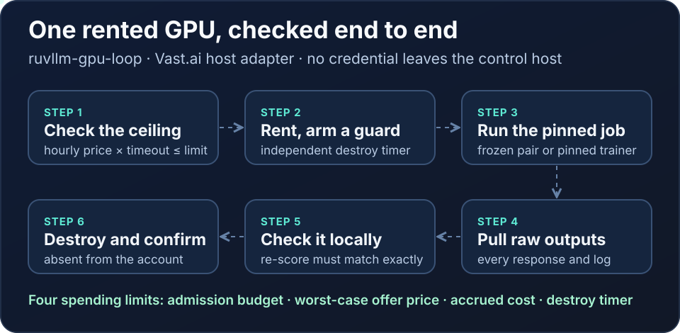
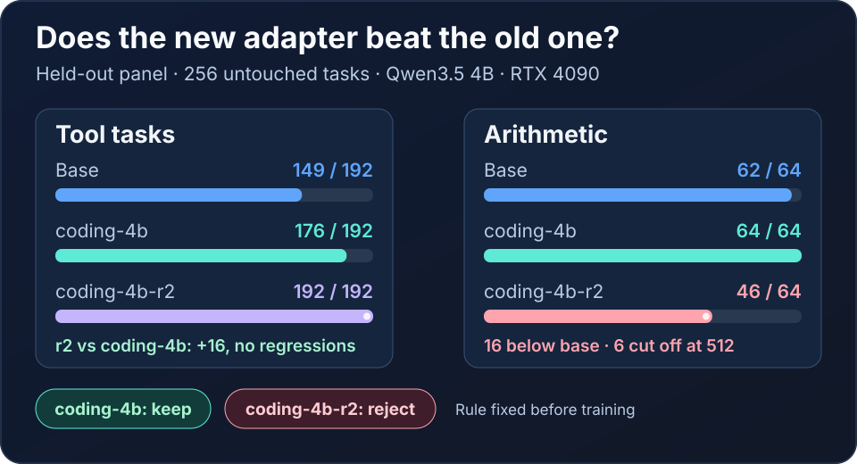

# MetaHarness weight experiments

<p align="center"></p>

<p align="center"></p>

Published on npm as [`@ruvector/ruvllm-gpu-loop`](https://www.npmjs.com/package/@ruvector/ruvllm-gpu-loop).
The package ships the JavaScript controller, GPU loop and Vast.ai host adapter.
It does not ship the native `weight_evolution` binary, model weights or
adapters. Build the binary from this repository and pass its path with
`--binary`.

```sh
npm install @ruvector/ruvllm-gpu-loop
npx ruvllm-gpu --help        # bounded weight-edit experiments
npx ruvllm-gpu-loop status --config /abs/private/gpu-loop.json
```

### Package name: `@ruvector/ruvllm-gpu-loop`, not `@ruvector/ruvllm`

Versions 4.0.0 and 4.0.1 of this harness were published as `@ruvector/ruvllm`
by mistake. That name belongs to the RuVLLM inference runtime (GGUF inference,
TurboQuant KV cache, SONA, FlashAttention) built from
[`ruvnet/RuVector`](https://github.com/ruvnet/RuVector/tree/main/npm/packages/ruvllm),
and the 4.0.x upload replaced it for everyone. `@ruvector/ruvllm@4.1.0`
restores the runtime and depends on this package, so its GPU-loop subpaths keep
working:

| 4.0.x (`@ruvector/ruvllm`) | Now (`@ruvector/ruvllm-gpu-loop`) | Via `@ruvector/ruvllm@^4.1.0` |
| :--- | :--- | :--- |
| `import … from '@ruvector/ruvllm'` (`runExperiment`) | `import … from '@ruvector/ruvllm-gpu-loop'` | `@ruvector/ruvllm/engine` |
| `@ruvector/ruvllm/gpu-loop`, `/adapters`, `/gpu-host`, `/gpu-spool-adapter`, `/vast-host-adapter`, `/fixture` | same subpaths on `@ruvector/ruvllm-gpu-loop` | same subpaths |
| `npx ruvllm run …` / `npx ruvllm fixture …` | `npx ruvllm-gpu run …` / `npx ruvllm-gpu fixture …` | `npx ruvllm gpu run …` |
| `npx ruvllm-gpu-loop`, `npx ruvllm-adapters` | unchanged | unchanged |

A `prepublishOnly` guard (`scripts/check-package-name.mjs`) refuses to publish
this package under the runtime's name.

Run multiple bounded RuVLLM edits against one unchanged checkpoint, validate
supplied evaluations, package RVF evidence, restore every patched checkpoint,
and rank research-qualified candidates through MetaHarness. This controller
uses the actual Flywheel, Darwin and Weight-EFT packages pinned in
[package-lock.json](package-lock.json).

The runner does not perform inference, discover an effective weight edit, train
an adapter or activate a model. CPU fixtures exercise real file editing and
restoration with explicitly synthetic evaluation receipts. External evaluation
files remain caller-supplied evidence; hashes do not authenticate their origin.

## Install and run the CPU fixture

Requirements: Linux or macOS, Node 22+, Python 3.12+, a C linker, and Rust 1.97.1
as pinned by `native/rust-toolchain.toml`. Activate any locally installed Rust
toolchain before using Cargo. From the repository root:

```sh
(cd integrations/metaharness && npm ci --ignore-scripts)
(cd native && cargo build --locked --release --bin weight_evolution)
python3 native/verify_source.py
node integrations/metaharness/src/cli.mjs fixture \
  --dir "$PWD/runtime/metaharness-fixture" \
  --binary "$PWD/native/target/release/weight_evolution"
```

Create the fixture's parent directory first (`mkdir -p runtime`). Its own directory
must not exist: exclusive creation prevents accidental replacement. For another
fixture use a new directory. The report should select `fixture-improvement`, leave
`unevaluated-control` unqualified, verify RVF and exact rollback for both, and
report `inferencePerformed: false`, `independentConfirmation: false` and
`productionActivation: false`. A selected synthetic candidate says nothing about
actual model accuracy.

## Configure real experiment inputs

Prepare reviewed source checkpoint, patch, policy and optional evaluation JSON
under explicit input roots. Native request/data contracts are described in the
[native guide](../../native/README.md). Patch generation remains model specific;
the controller does not guess useful tensor edits.

Run the project-local installer with paths you control:

```sh
bash scripts/install-metaharness.sh \
  --config-dir /absolute/private/operator-profile \
  --read-root /absolute/checkpoints \
  --read-root /absolute/experiment-inputs \
  --policy /absolute/experiment-inputs/policy.json \
  --output-root /absolute/private/experiment-outputs
```

It installs frozen npm dependencies without lifecycle scripts, builds the native
binary, verifies native provenance and runs its smoke fixture. It creates a
private runtime profile and Claude launcher without changing global settings.
Repeat `--read-root`/`--policy` for additional approved inputs. Existing profile
files are never replaced; use another directory for a new profile. Existing config
and output directories must be owner-only. `--configure-only` skips installation
and building but still checks native readiness.

Example plan inside an approved read root:

```json
{
  "schema": "ruvllm-experiment-plan/v1",
  "evidenceMode": "external",
  "source": "/absolute/checkpoints/source.safetensors",
  "policy": "/absolute/experiment-inputs/policy.json",
  "candidates": [
    {
      "id": "candidate-01",
      "patch": "/absolute/experiment-inputs/patch.json",
      "evaluation": "/absolute/experiment-inputs/evaluation.json"
    }
  ]
}
```

```sh
node integrations/metaharness/src/cli.mjs run \
  --config /absolute/private/operator-profile/runtime.json \
  --plan /absolute/experiment-inputs/plan.json
```

Omit `evaluation` to run mechanical checks without qualification. After an external
inference runner has evaluated a candidate, submit its hash-bound evaluation in a
new plan/run. Candidate checkpoint hashes are deterministic for the same patch;
new artifact paths do not relax identity checks. Paired baseline, protocol, suite,
runtime, precision and output-budget consistency remain the evaluator's responsibility.

Runs use new private `run-*` directories and preserve rejected candidates. Reports
bind config/plan/source/policy/binary/gate/patch/evaluation identities and record
rollback and RVF verification. Native rejection records a reason. Structural or
restoration failures abort; interrupted runs can leave artifacts. Reconcile those
directories before retrying; never erase failed evidence to manufacture success.

## Claude Code and Ruflo

Load [ruflo-metaharness](../../plugins/ruflo-metaharness/README.md) using the
generated `launch-claude.sh`, or set `RUVLLM_EXPERIMENT_CONFIG` and use Claude's
`--plugin-dir`. The `/ruflo-metaharness:weight-experiment` command and reviewer
agent guide the bounded workflow. Its single MCP tool accepts a plan path; the
model cannot override the operator configuration. The same stdio server can be
registered in a Ruflo project's MCP configuration. Portable wire tests exercise
the real engine; installed Claude/Ruflo client acceptance is separate.

## Scheduled GPU work

For scheduled GPU work, use the [durable GPU loop](GPU-LOOP.md). It supports
host-owned ruOS secret references, Vast job descriptors, persisted reservations,
deadline-aware polling and confirmed cleanup. Local contract tests require no
live provider. The bundled file handoff keeps requests pending for a trusted host.

## Weight-EFT data and plans

The data-only adapter CLI reads JSON stdin, with a 16 MiB bound:

```sh
node integrations/metaharness/src/adapters-cli.mjs export < reviewed-archive-input.json > export.json
node integrations/metaharness/src/adapters-cli.mjs training-plan < training-input.json > plan.json
node integrations/metaharness/src/adapters-cli.mjs select < measured-candidates.json > selection.json
```

`export` takes `{archive, evalHoldout, maxTokens?}`. Archive entries follow the
pinned Weight-EFT `DarwinTrajectory` contract (`instance_id`, `model`, `tier`,
boolean `resolved`, `messages`, `model_patch`). All actual evaluation instance IDs
must be in `evalHoldout`. Output contains standard `sft`/`dpo` arrays, drop reports
and input hashes. Reward-hacking filtering stays enabled, overlength traces are
dropped, and tool calls are preserved. These filters cannot authenticate outcomes
or detect all semantic contamination.

`training-plan` takes `{base:{id,paramsB},sftPath,dpoPath,adapterPrefix}`. It emits
upstream plans plus `executionStatus: not_executed` and
`runnerCompatibility: adapter-required`. This repository has no upstream
`ruvllm microlora` executable. Its existing fixed CUDA/PEFT experiment runner is
not a configurable SFT/DPO trainer. No GPU, model download or paid job is started.

`select` takes `{baseline,candidates,envelope}` with entries
`{id,score,evidenceSha256}`. It replays finite, supplied scores through Darwin's
contrastive engine. It is development ranking with an immutable envelope and no
independent confirmation; it cannot authenticate caller-supplied evidence. The
native runner applies its stricter qualification first.

## Tests and benchmark

```sh
(cd integrations/metaharness && npm test)
node --test plugins/ruflo-metaharness/test/*.test.mjs
node integrations/metaharness/bench/run.mjs --iterations 7 --warmup 2 --candidates 2
```

Tests require the built native binary. In restricted agent environments the Node
test runner, native child processes and package fetching may require the host's
supported execution permission. Verify actual subtest counts; a file-only runner
summary is insufficient evidence. Do not disable TLS/checksums or native checks.

The benchmark compares fresh versus reused Node processes on identical CPU
fixtures, retaining raw latency samples and implementation/binary/lock hashes.
The reused process matches the MCP server architecture. All native hashing,
patch validation and byte restoration remain enabled. See the
[benchmark report](../../docs/benchmarks/metaharness-cpu.md) for measured scope
and limits; no model-performance claim follows from orchestration speed.

Architecture and threat boundaries are recorded in
[ADR 012](../../docs/adr/ADR-012-metaharness-bounded-experiment-runner.md),
[ADR 013](../../docs/adr/ADR-013-training-and-development-selection.md) and
[ADR 014](../../docs/adr/ADR-014-claude-ruflo-integration.md).
